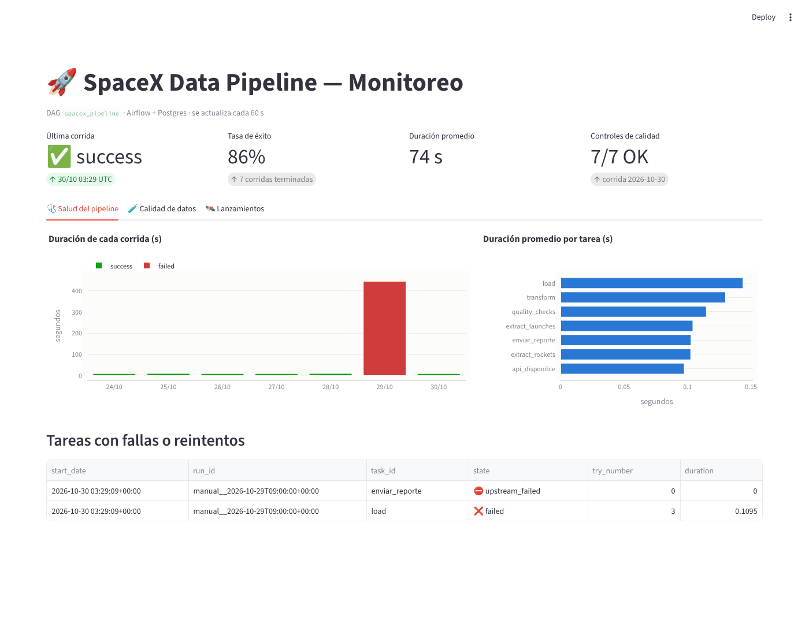
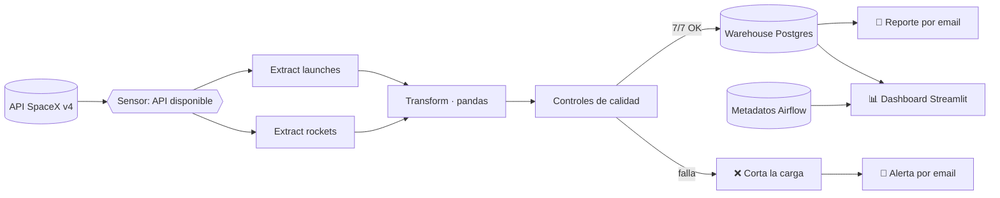

# 🚀 SpaceX Data Pipeline

[](https://github.com/javierGrondon/spacex-data-pipeline/actions/workflows/ci.yml)

Pipeline de datos de punta a punta orquestado con **Apache Airflow**. Extrae lanzamientos y cohetes de la API pública de SpaceX y aplica **controles de calidad de datos**. Carga el resultado en un warehouse **Postgres** y avisa **por email** cuando termina o cuando falla. Un **dashboard de monitoreo** en Streamlit muestra la salud del pipeline y los datos.

Todo levanta con un solo comando: `docker compose up`.



## Arquitectura



## Qué muestra este proyecto

| Práctica | Cómo está implementada |
|---|---|
| Orquestación | DAG con **TaskFlow API**, ejecución diaria, `catchup=False`, `max_active_runs=1` |
| Resiliencia | Sensor en modo `reschedule` que espera a que la API responda; **reintentos con backoff exponencial** y `execution_timeout` |
| Calidad de datos | 7 controles: tablas no vacías, IDs únicos, fechas sin nulos, integridad referencial con cohetes, estados válidos y consistencia de los próximos lanzamientos. Si uno falla, **no se cargan datos malos** |
| Idempotencia | Carga *full refresh*. El log de calidad se reescribe por fecha, así que volver a correr un día no duplica datos |
| Alertas | **Operador personalizado** `EmailReportOperator` con plantillas Jinja (`{{ ds }}`, XCom) y `on_failure_callback` que manda un email con la tarea, el error y el link al log |
| Monitoreo | Dashboard que lee los **metadatos de Airflow** (corridas, duraciones, fallas, reintentos) y el warehouse (calidad y negocio) |
| Testing y CI | `pytest` (ETL, calidad e integridad del DAG) en **GitHub Actions**, con las mismas versiones que la imagen Docker |
| Separación de responsabilidades | La lógica ETL vive en `dags/spacex_etl/` como Python puro, testeable sin Airflow |

## Estructura

```
├── dags/
│   ├── spacex_pipeline.py        # definición del DAG
│   └── spacex_etl/               # extract / transform / quality / load
├── plugins/
│   ├── alerting.py               # envío SMTP + callback de falla
│   └── email_report_operator.py  # operador personalizado
├── dashboard/                    # app Streamlit + Dockerfile
├── sample_data/                  # datos de muestra sintéticos (modo offline / tests)
├── tests/
├── docker/postgres/init.sql      # crea la base "warehouse"
├── docker-compose.yml
└── .github/workflows/ci.yml
```

## Cómo correrlo

**Requisito:** [Docker Desktop](https://www.docker.com/products/docker-desktop/) (Windows, Mac o Linux).

```bash
git clone https://github.com/javierGrondon/spacex-data-pipeline.git
cd spacex-data-pipeline
cp .env.example .env        # en Windows: copy .env.example .env
docker compose up -d
```

La primera vez tarda unos minutos en bajar las imágenes. Después:

- **Airflow:** http://localhost:8080 (usuario `admin`, contraseña `admin`). El DAG `spacex_pipeline` arranca activado; lanzalo con ▶.
- **Dashboard:** http://localhost:8501

Para apagar todo: `docker compose down`. Para borrar también los datos: `docker compose down -v`.

### Alertas por email (opcional)

En `.env` completá `SMTP_USER`, `SMTP_PASSWORD` y `ALERT_EMAIL_TO`. Con Gmail tenés que usar una [contraseña de aplicación](https://myaccount.google.com/apppasswords), no tu contraseña normal. Si no lo configurás, el pipeline corre igual y los emails quedan en el log de Airflow.

### Probar una falla

Para ver la alerta en acción, poné `USE_SAMPLE_DATA=true` en `.env`, duplicá una entrada en `sample_data/launches.json` y lanzá el DAG. El control `launch_id_unico` falla, la carga se frena, Airflow reintenta y llega el email de alerta.

### Sin internet o si la API no responde

Con `USE_SAMPLE_DATA=true` el pipeline usa datos **sintéticos** con el mismo formato de la API. Se generan solos la primera vez con `sample_data/generate_sample.py`.

## Tests

```bash
pip install -r requirements-dev.txt \
  --constraint https://raw.githubusercontent.com/apache/airflow/constraints-2.10.5/constraints-3.12.txt
airflow db migrate
pytest -v
```

## Stack

Apache Airflow 2.10 · Python 3.12 · pandas · SQLAlchemy · PostgreSQL 16 · Streamlit · Plotly · Docker Compose · GitHub Actions

## Notas

- La API pública de SpaceX (r/SpaceX) es comunitaria y su historial no está actualizado hasta hoy. El proyecto se centra en la ingeniería del pipeline más que en la novedad de los datos.
- Las capturas de `docs/` se generaron con los datos de muestra.
